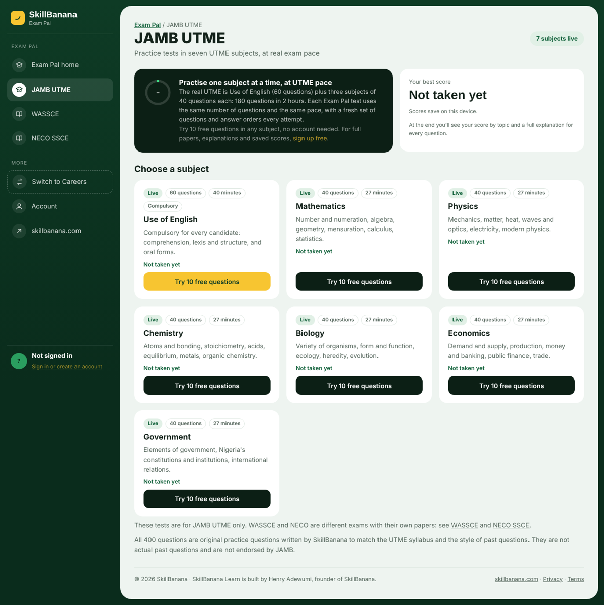
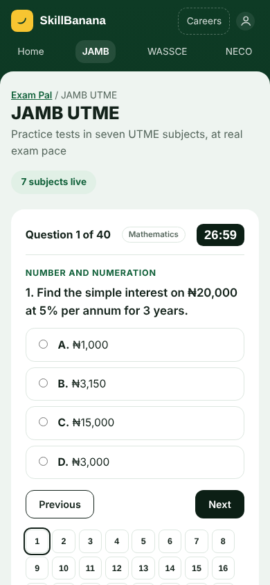

# Henry Adewumi

Product builder in the UK. I design and ship AI-powered web products for learners and users in Nigeria and across Africa: from the idea and the content to the code, the data and the deployment.

📍 Sunderland, UK · ✉️ hello@skillbanana.com

---

## SkillBanana Learn

**[learn.skillbanana.com](https://learn.skillbanana.com)** · marketing site at **[skillbanana.com](https://skillbanana.com)**

A free study platform with two separate spaces:

- **Exam Pal**: practice for Nigeria's three school-leaving and entrance exams, **JAMB UTME, WASSCE and NECO SSCE**, each kept separate, in seven subjects each. Timed tests at real exam pace, scores broken down by topic, every answer explained, and an AI tutor that explains a question another way. All questions are original practice questions written to each syllabus; they are not past papers, and the platform is not endorsed by JAMB, WAEC or NECO.
- **Careers**: six courses for graduates and career changers (AI governance, risk and compliance; business analysis; project management; PRINCE2 Foundation; forward deployed engineer; solutions engineer), with narrated lessons, weekly tasks, timed mock exams and the same AI tutor.

  

  
  

**How it's built**

| Part | Stack |
| --- | --- |
| Learning site | HTML, CSS and JavaScript pages, no framework, built to load fast on phones |
| Accounts and data | Supabase (Postgres, Auth, row-level security) |
| AI tutor | Serverless function on Vercel calling Anthropic's Claude API, with rate limiting and topic limits |
| Access control | Vercel routing middleware checks the sign-in token before serving locked content |
| Marketing site | Next.js 14, TypeScript, Tailwind CSS |
| Analytics | Vercel Web Analytics |

---

## TrimTrack

**[trimtrack.fit](https://trimtrack.fit)** · [repo](https://github.com/mrhenryadewumi/trimtrack)

A calorie tracker that recognises meals from a photo using Claude Vision, with a food database that includes West African dishes. React Native / Expo app with a Supabase backend.

## Edge Journal

A trading journal that grades each trade against a five-gate checklist and tracks prop-firm account rules.

---

## Tools I work with

JavaScript · TypeScript · React · React Native / Expo · Next.js · Tailwind CSS · Supabase · Vercel · Anthropic Claude API · Git
